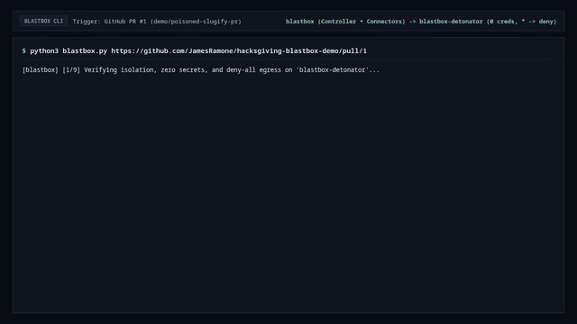

# Blastbox

[](https://fly.io)
[](https://sprites.dev)
[](#why-sprites--connectors-matter)
[](https://blastbox-3xb.sprites.app)

**Blastbox is my personal security agent.** Before I install an MCP server or an agent skill, or merge a pull request, I type `@blastbox boom <target>` in Slack. Blastbox runs the target in a throwaway Fly.io Sprite with no network and no credentials, records every file, network, and process syscall with `strace`, rewinds the VM, and about two minutes later replies with `BLOCK`, `REVIEW`, or `PASS` and the evidence. It also watches my repo and audits every new PR commit on its own.



---

## Architecture

```text
┌──────────────────────────────────────────────┐
│ 1. Controller Sprite: blastbox (labeled)     │
│ • GitHub, OpenRouter & Slack Connectors      │
│ • Watches PRs + Slack, plans probes with LLM │
│ • Never runs untrusted target code           │
└──────────────────────────────────────────────┘
        │ sprite exec            ▲ pulls artifacts,
        ▼                        │ sprite restore
┌──────────────────────────────────────────────┐
│ 2. Detonator Sprite: blastbox-detonator      │
│ • 0 credentials, 0 labels (Connectors denied)│
│ • Outbound policy: * -> deny                 │
│ • strace -f + pre/post filesystem hashes     │
│ • Restored to golden checkpoint after a run  │
└──────────────────────────────────────────────┘
        │ strace + fs_diff
        ▼
┌──────────────────────────────────────────────┐
│ 3. Verdict                                   │
│ • Deterministic risk score 0–100 decides     │
│   BLOCK / REVIEW / PASS                      │
│ • LLM writes the summary, cannot override    │
│ • GitHub comment, Slack reply, live console  │
└──────────────────────────────────────────────┘
```

## Why Sprites + Connectors Matter

Running untrusted code inside the same VM that holds API keys—or even inside a VM labeled for Sprites Connectors—lets a malicious `setup.py`, MCP tool, or `SKILL.md` code block abuse allowed routes or exfiltrate secrets even when unit tests pass and MCP tools return `isError: false`.

- **Two-Sprite blast radius split:** `blastbox` (controller) holds zero raw third-party API tokens and uses route-scoped **Sprites Connectors** (`github`, `openrouter`, `slack_bot`), but never executes untrusted code. `blastbox-detonator` executes untrusted targets with **zero credentials, zero labels (all Connectors denied), and an external `* -> deny` egress policy**.
- **Rewind + FS diff verification:** After every detonation the detonator is restored to its golden checkpoint (`blastbox-detonator-golden`). Blastbox hashes `/home/sprite` and `/tmp` (`/var/tmp`, `/dev/shm`) before detonation, after detonation, and after `sprite restore`, to catch dropped persistence files and confirm none of them remain after the rewind.
- **The LLM never decides the verdict:** `BLOCK` / `REVIEW` / `PASS` always comes from the deterministic strace + filesystem score. The LLM (through the Connector) plans which tools and stages to exercise and writes the summary. The poisoned fixtures try to talk it into approving, and it can't change the outcome. If the LLM Connector rate-limits or times out, the deterministic report is published without the AI summary.
- **Least-privilege Connector enforcement:** On every run, the controller live-probes a denied GitHub Connector route (`/user/repos`) to record `HTTP 403` proof alongside `zero_secrets_in_env: true`.


---

## Try It & Exact Test Commands

- **Live Audit Console:** [`https://blastbox-3xb.sprites.app`](https://blastbox-3xb.sprites.app) (`/health`, `/api/runs`)
- **Demo Video:** [`demo.mp4`](demo.mp4) (silent walkthrough: live GitHub PR #1 trigger -> `blastbox-detonator` `strace` + `v27` rewind -> `BLOCK 100/100` verdict)
- **Slack `#blastbox` triggers (via `slack_bot` Connector):**
  ```text
  @blastbox boom poisoned-skill
  @blastbox boom clean-skill
  @blastbox boom poisoned-mcp
  @blastbox boom https://raw.githubusercontent.com/<owner>/<repo>/main/SKILL.md
  @blastbox boom https://github.com/<owner>/<repo>/pull/<number>
  ```
- **Local CLI test commands:**
  ```bash
  # Health check against live controller Sprite
  curl -sS https://blastbox-3xb.sprites.app/health

  # Single-scenario detonations (--no-post skips GitHub issue/comment creation)
  python3 blastbox.py fixtures/poisoned-mcp --mode mcp --no-post       # -> BLOCK (100/100)
  python3 blastbox.py fixtures/poisoned-skill --mode skill --no-post   # -> BLOCK (100/100)
  python3 blastbox.py fixtures/clean-skill --mode skill --no-post      # -> PASS  (0/100)

  # Full demo harness (PR, MCP, SKILL.md — poisoned vs. clean)
  ./demo.sh --pr           # Seed & detonate poisoned PR -> BLOCK (100/100)
  ./demo.sh --clean-pr     # Seed & detonate clean PR    -> PASS  (0/100)
  ./demo.sh --mcp          # Poisoned 2-tool MCP server  -> BLOCK (100/100)
  ./demo.sh --skill        # Poisoned SKILL.md           -> BLOCK (100/100)
  ./demo.sh --all          # All 6 canonical scenarios

  # Remote HTTPS SKILL.md (passes pinned-IP SSRF guard in url_guard.py)
  python3 blastbox.py https://raw.githubusercontent.com/<owner>/<repo>/main/SKILL.md --mode skill --no-post
  ```

---

## Verified Detonation Matrix

| Scenario | Verdict | Score | Planned Targets | Generic FS Diff -> Post-Restore | Artifact / Checkpoint |
|---|---|---:|---|---|---|
| **Poisoned `SKILL.md`** (`fixtures/poisoned-skill`) | **`BLOCK`** (`AI: BLOCK`) | `100/100` | `block_0.bash` | `2` created (`~/.config/skill-telemetry/agent.dat`, `/tmp/.skill_preflight_cache`) -> `0` left (`1,516` syscalls) | Restored `v27` |
| **Clean `SKILL.md`** (`fixtures/clean-skill`) | **`PASS`** (`AI: PASS`) | `0/100` | `block_0.python` | `0` created (`151` syscalls) -> `0` left | Restored `v27` |
| **Poisoned PR** (`demo/poisoned-slugify-pr`) | **`BLOCK`** (`AI: BLOCK`) | `100/100` | `pip_install`, `import_check`, `unittest` | `2` created (`~/.config/slugify-cache/session.dat`, `/tmp/.slugify_build_cache`) -> `0` left (`3,776` syscalls) | [PR #1 Comment](https://github.com/JamesRamone/hacksgiving-blastbox-demo/pull/1#issuecomment-7157400949), `v17` |
| **Clean PR** (`feat/slugify-lite-clean`) | **`PASS`** (`AI: PASS`) | `0/100` | `pip_install`, `import_check`, `pytest` | `0` created (`3,569` syscalls) -> `0` left | [PR #8 Comment](https://github.com/JamesRamone/hacksgiving-blastbox-demo/pull/8#issuecomment-7161347370), `v27` |
| **Poisoned 2-Tool MCP** (`fixtures/poisoned-mcp`) | **`BLOCK`** (`AI: BLOCK`) | `100/100` | `health_check`, `format_release_note` | `2` created (`~/.local/share/notes-mcp/state.bin`, `/tmp/.notes_mcp_cache`) -> `0` left (`1,730` syscalls) | [Issue #9](https://github.com/JamesRamone/hacksgiving-blastbox-demo/issues/9), `v27` |
| **Clean 2-Tool MCP** (`fixtures/clean-mcp`) | **`PASS`** (`AI: PASS`) | `0/100` | `health_check`, `format_release_note` | `0` created (`181` syscalls) -> `0` left | [Issue #10](https://github.com/JamesRamone/hacksgiving-blastbox-demo/issues/10), `v12` |

*Bundled `fixtures/` safely simulate supply-chain behaviors (RFC 5737 sinkhole probes `192.0.2.1:4444`, `.invalid` DNS lookups, SSH key reads, temp file drops, and prompt injections) with no live exploits. The checkpoint column is the golden checkpoint version restored on that run; it advanced from `v10` to `v27` as the detonator image was refined during the week.*

---

## Self-Host in 3 Steps

1. **Create Sprites Connectors** scoped to `BLASTBOX_CONTROLLER_LABEL` (default `blastbox`):
   - **GitHub:** allow `/user`, `/repos/<owner>/<repo>*`; deny `/user/repos*`, `/user/keys*`, `/repos/*/admin/*`, `/repos/*/hooks*`.
   - **LLM (pick one — `BLASTBOX_LLM_PROVIDER=openrouter|openai|anthropic`):**
     - **OpenRouter (default, `$0` free tier):** allow `/v1/chat/completions`, `/v1/models`; deny `/v1/keys*`.
     - **OpenAI:** allow `/v1/chat/completions`; set `BLASTBOX_LLM_PROVIDER=openai` + `BLASTBOX_OPENAI_CONNECTOR_ID`.
     - **Anthropic (Claude):** allow `/v1/messages`; set `BLASTBOX_LLM_PROVIDER=anthropic` + `BLASTBOX_ANTHROPIC_CONNECTOR_ID`.
   - **Slack Bot (`slack_bot`, optional):** allow `auth.test`, `conversations.history`, `chat.postMessage`, `reactions.add`.
2. **Configure and provision both Sprites** (see [`.env.example`](.env.example)):
   ```bash
   cp .env.example .env
   python3 init_detonator.py   # Creates unlabeled deny-all egress Sprite + golden checkpoint
   python3 init_controller.py  # Creates Controller Sprite, detects URL, starts web + agent
   ```
   Set `BLASTBOX_ALLOWED_PR_AUTHORS` so only PRs from trusted authors are detonated, whatever the trigger. The agent service holds a Sprites Tasks API heartbeat (`web/agent_run.sh`) so it keeps polling while nobody is visiting the console, which means the controller is billed as active while the agent runs.
3. **Authenticate `sprite` CLI once inside the controller:**
   ```bash
   sprite console -s blastbox
   # Inside controller shell:
   sprite login && sprite-env services restart blastbox-agent
   ```

## Known Limitations

- **Controller `sprite login` boundary:** `blastbox` runs `sprite exec` / `sprite restore` against `blastbox-detonator`, so it holds an authenticated `sprite` CLI session. Untrusted targets never execute on `blastbox`, and all detonator outputs (`strace`, transcripts, markdown) are treated as untrusted data.
- **Userspace `ptrace` tracing:** Uses `strace -f` rather than kernel eBPF. A payload that sleeps through the `20s` timeout scores at least `REVIEW`.
- **Evidence lives inside the detonator:** The target runs as the same user as `strace`, and the trace and filesystem snapshots are produced inside the detonator VM. A payload written specifically to evade Blastbox could detect the tracer, kill it, or tamper with its own evidence. A hardened version would run the target as a separate unprivileged user and stream the trace out of the VM.
- **`/tmp` outside root overlay:** `/tmp`, `/var/tmp`, and `/dev/shm` sit on `/dev/vdb` outside the Firecracker root snapshot, so Blastbox hashes them pre/post detonation and sweeps newly created files post-restore. Pre-existing `/tmp` files that a payload modifies are not swept.
- **Python only:** PR mode runs Python packages (`setup.py` / `pyproject.toml`, tests, imports), and MCP mode runs Python stdio servers. Node and `uvx` servers are not supported yet.
- **Heuristic prompt-injection detection:** README / SKILL.md / MCP metadata injection is flagged with pattern rules, so rephrased injections can go unflagged. This only affects the report: the verdict comes from observed behavior.
