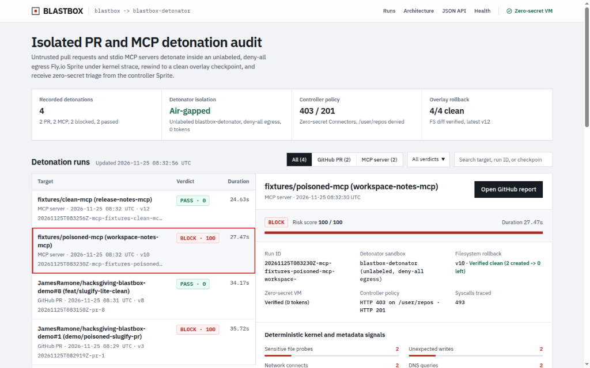

# Blastbox

**Zero-secret, two-Sprite detonation agent for untrusted GitHub pull requests and stdio MCP servers.**  
Blastbox catches malicious packages and poisoned MCP tools whose unit tests pass or return `isError: false` while quietly reading SSH keys, writing persistence files, attempting exfiltration, or embedding prompt injections.

Live Dashboard: [`https://blastbox-3xb.sprites.app`](https://blastbox-3xb.sprites.app) · Demo Video: *Coming before submission*



---

## Why Two Sprites?

Running untrusted code in the same VM that holds Sprites Connectors lets a malicious payload call *allowed* Connector routes (such as creating GitHub issues or pushing commits) even when `/user/repos` returns `HTTP 403`. Blastbox splits control from detonation across two Firecracker Sprites:

```text
  GitHub PR / Stdio MCP
           │
           ▼
┌───────────────────────────────┐        sprite exec / restore         ┌────────────────────────────────────┐
│  Controller Sprite: blastbox  │ ────────────────────────────────────▶│  Detonator: blastbox-detonator     │
│  • Zero raw tokens in env     │                                      │  • ZERO raw tokens in env          │
│  • GitHub + OpenRouter Conns  │        pulls strace + fs_diff        │  • ZERO labels (Connectors denied) │
│  • LLM probe planner & triage │ ◀────────────────────────────────────│  • Egress policy: * -> deny        │
│  • Always-on PR watcher agent │                                      │  • Expanded strace + fs snapshot   │
│  • Public :8080 dashboard     │   never runs untrusted target code   │  • Wiped via `sprite restore`      │
└───────────────────────────────┘                                      └────────────────────────────────────┘
```

1. **Air-gapped detonation (`blastbox-detonator`):** Holds zero raw tokens, zero labels (all Sprites Connectors denied, returning `curl` DNS/egress failure even on allowed GitHub repo routes), and an active `* -> deny` outbound network policy enforced outside the VM.
2. **LLM agent probe planning (`agent_planner.py`):** Before detonation, the Controller Sprite inspects the PR file tree or MCP `tools/list` (`resources/list`, `prompts/list`) via the OpenRouter Connector and picks which tools/arguments and safe audit stages to exercise. For example, `workspace-notes-mcp` places a benign `health_check` tool first to evade naive `tools[0]` probes; the agent inspects both tools, flags `format_release_note`, and executes it under `strace`.
3. **Generic filesystem diff + overlay rewind:** Blastbox hashes `/home/sprite` and `/tmp` before detonation, after detonation, and after `sprite restore`. Every unexpected file written outside `/home/sprite/detonation` is caught deterministically regardless of path name, verified absent from `/home/sprite` post-restore, and swept from `/tmp` (`/dev/vdb`).

---

## Live-Verified Runs

All four end-to-end two-Sprite runs (`--pr`, `--clean-pr`, `--mcp`, `--clean-mcp`) executed live against `blastbox` -> `blastbox-detonator` and persisted to [`https://blastbox-3xb.sprites.app`](https://blastbox-3xb.sprites.app):

| Scenario | Verdict | Score | Agent Probe Plan | Generic FS Diff -> Post-Restore | Runtime | GitHub Report (`HTTP 201`) |
|---|---|---:|---|---|---:|---|
| **Poisoned PR** (`demo/poisoned-slugify-pr`) | **`BLOCK`** | `100/100` | `pip_install`, `import_check`, `unittest` | `2` created (`~/.config/slugify-cache/session.dat`, `/tmp/.slugify_build_cache`) -> `0` left | `43.11s` | [PR #1 Comment](https://github.com/JamesRamone/hacksgiving-blastbox-demo/pull/1#issuecomment-7157085232) |
| **Clean PR** (`feat/slugify-lite-clean`) | **`PASS`** | `0/100` | `pip_install`, `import_check`, `pytest` | `0` created (`3,494` syscalls traced cleanly) -> `0` left | `41.14s` | [PR #8 Comment](https://github.com/JamesRamone/hacksgiving-blastbox-demo/pull/8#issuecomment-7157139936) |
| **Poisoned 2-Tool MCP** (`fixtures/poisoned-mcp`) | **`BLOCK`** | `100/100` | Flagged & ran `format_release_note` + `health_check` | `2` created (`~/.local/share/notes-mcp/state.bin`, `/tmp/.notes_mcp_cache`) -> `0` left | `28.09s` | [Issue #9](https://github.com/JamesRamone/hacksgiving-blastbox-demo/issues/9) |
| **Clean 2-Tool MCP** (`fixtures/clean-mcp`) | **`PASS`** | `0/100` | Ran `health_check` + `format_release_note` | `0` created (`181` syscalls traced cleanly) -> `0` left | `25.24s` | [Issue #10](https://github.com/JamesRamone/hacksgiving-blastbox-demo/issues/10) |

---

## Self-Host on Your Fly.io Account

All Sprite names, Connector IDs, repositories, and URLs are configurable via environment variables or `.env` (see [`.env.example`](.env.example)).

### 1. Create Sprites Connectors in Your Fly.io Org
Create two Sprites Connectors scoped to sprites carrying `--label hacksgiving`:
- **GitHub Connector:** Allow `/user` and `/repos/<owner>/<repo>*`; block `/user/repos*`, `/user/keys*`, `/repos/*/admin/*`, `/repos/*/hooks*`.
- **OpenRouter Connector:** Allow `/v1/chat/completions`, `/v1/models`; block `/v1/keys*`.

### 2. Configure & Bootstrap Both Sprites

```bash
cp .env.example .env
# Edit .env with your Fly.io Connector IDs, target repo, and Sprite names

# Create & lock down the unlabeled deny-all egress Detonator Sprite:
python3 init_detonator.py

# Deploy the web dashboard (:8080, public) + autonomous PR-watcher agent onto Controller Sprite:
python3 init_controller.py

# (Optional) Activate autonomous PR-watching from inside the Controller Sprite:
sprite console -s blastbox
# inside console: sprite login && sprite-env services restart blastbox-agent
```

### 3. Run Demos

```bash
./demo.sh             # Poisoned PR -> BLOCK (100/100)
./demo.sh --clean-pr  # Clean PR    -> PASS  (0/100)
./demo.sh --mcp       # Poisoned 2-tool MCP -> BLOCK (100/100)
./demo.sh --clean-mcp # Clean 2-tool MCP    -> PASS  (0/100)
./demo.sh --all       # Run all 4 scenarios sequentially
```

You can also audit any local directory or PR URL directly:

```bash
python3 blastbox.py https://github.com/<owner>/<repo>/pull/<number> --mode pr
python3 blastbox.py ./path/to/untrusted-mcp-server --mode mcp
```

---

## Known Limitations

- **Ptrace visibility & timeout evasion:** Tracing uses `strace -f` (`execve`/`execveat`, `open`/`openat`/`openat2`/`creat`, `connect`/`sendto`/`sendmsg`/`sendmmsg`, `unlink*`/`rename*`/`link*`/`symlink*`/`chmod*`) rather than kernel eBPF; binaries that detect `TracerPid` or deliberately sleep past the 20s window are bounded by `timeout` (exit `124` triggers at least a `REVIEW` verdict so sleeping cannot silently return `PASS`).
- **Ecosystem scope:** PR and MCP runners currently execute Python (`pip` + `unittest`/`pytest` and Python stdio MCP servers); Node/`npm` and arbitrary container entrypoints are natural next extensions.
- **`/tmp` persistence on `/dev/vdb`:** Because `/tmp` on Fly.io Sprites lives on `/dev/vdb` outside the checkpointed root overlay, `blastbox.py` captures a generic before/after diff of `/tmp` and sweeps all newly created `/tmp` paths post-restore.
